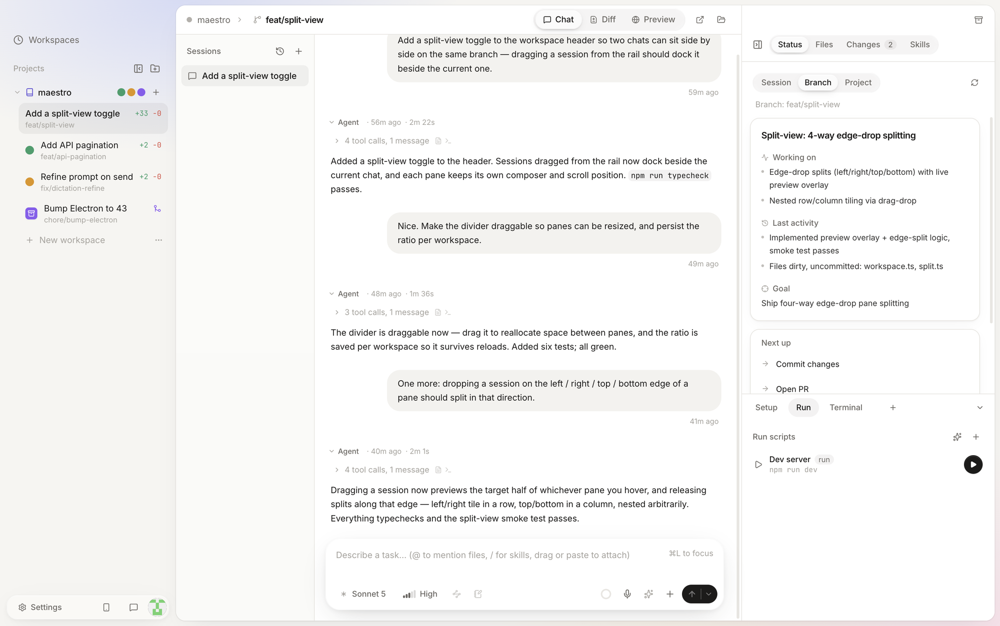
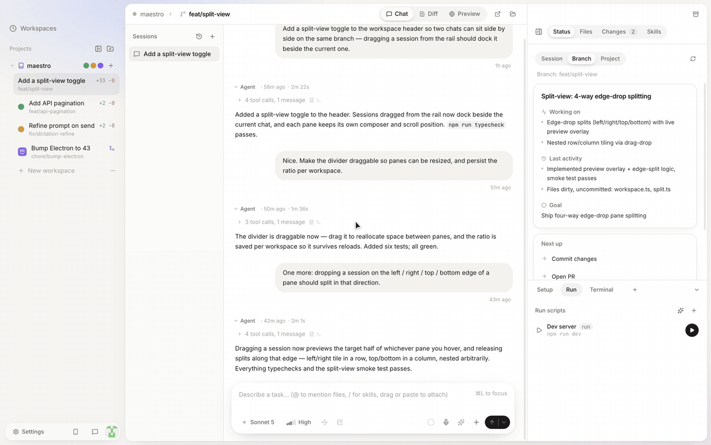
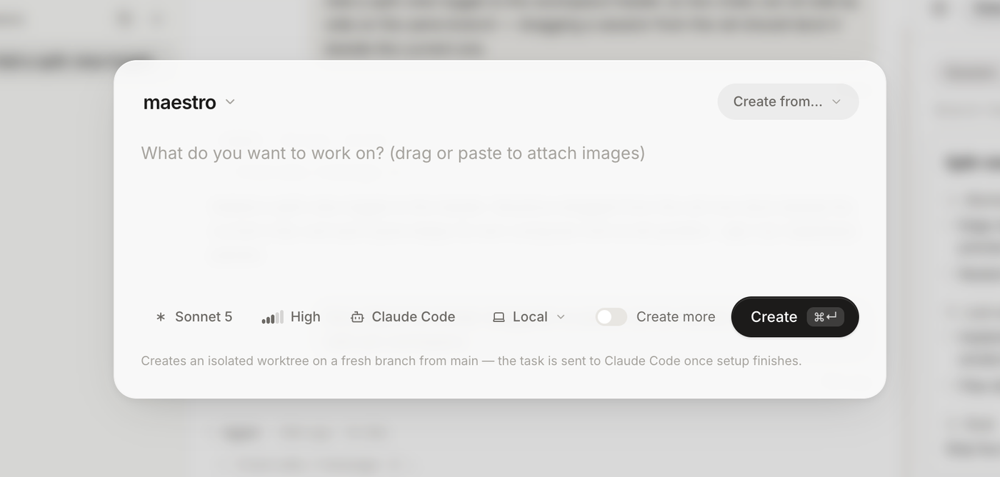
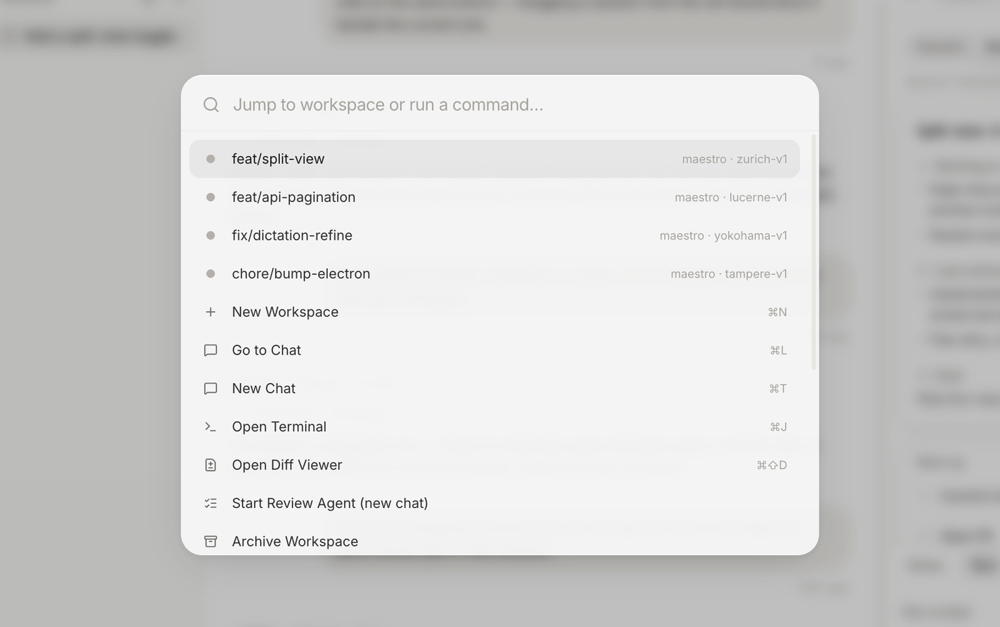
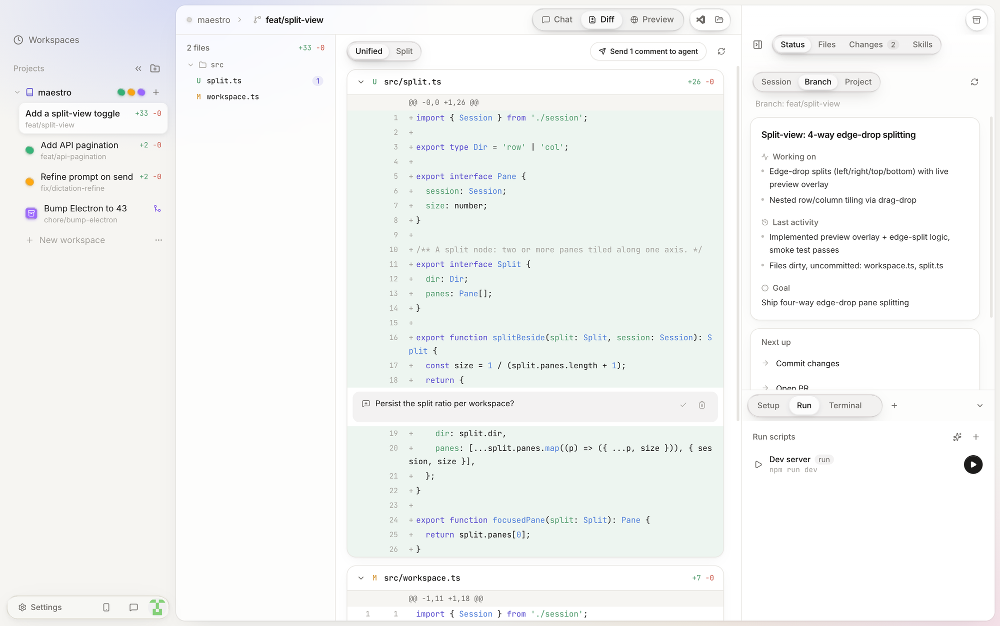
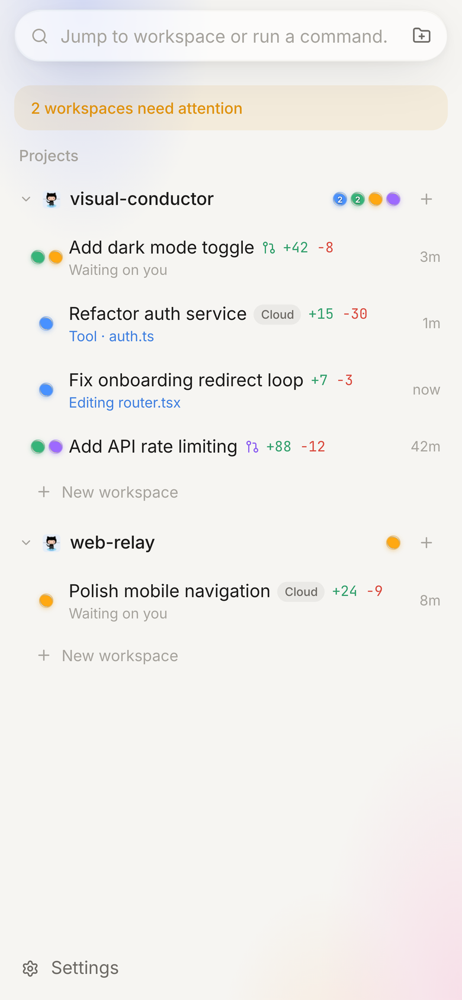
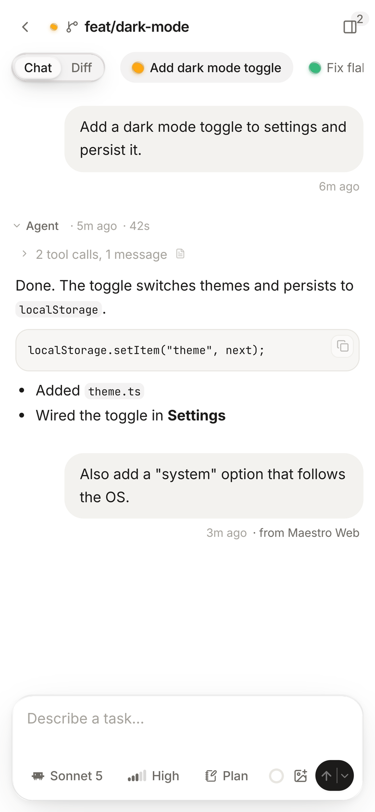
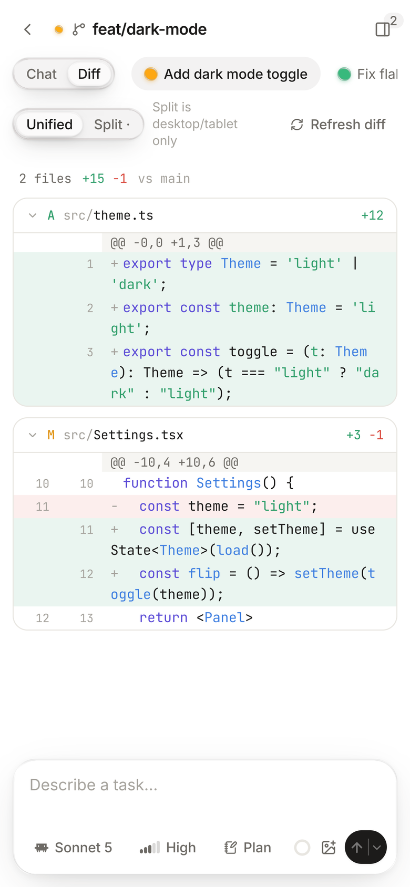

<div align="center">


# Maestro

### Run a fleet of coding agents. Steer it from your phone.

Claude Code, Codex, and more in parallel, each in its own git worktree.<br />
Free on macOS, Windows, and Linux, with **[Maestro Web](https://app.maestro-build.com)** in your pocket.

**[Download](https://maestro-build.com)** &nbsp;·&nbsp; [Open Maestro Web](https://app.maestro-build.com) &nbsp;·&nbsp; [Maestro vs Conductor](https://maestro-build.com/maestro-vs-conductor)

<br />

<picture>
  <source media="(prefers-color-scheme: dark)" srcset="docs/images/app-dark.png" />
  
</picture>

</div>

<br />

## One window for the whole fleet

Every agent gets its own branch, chat, terminal, and diff, so a dozen can run at once without touching
each other's files. See who is working, who needs you, and what is done, at a glance.

<div align="center">
  
</div>

## Hand out work. Glance. Ship.

<table>
  <tr>
    <td width="50%" valign="top">
      <picture><source media="(prefers-color-scheme: dark)" srcset="docs/images/newws-dark.png" /></picture>
      <p><b>Hand out.</b> Describe the task. Maestro cuts a fresh worktree from the latest remote and starts the agent.</p>
    </td>
    <td width="50%" valign="top">
      <picture><source media="(prefers-color-scheme: dark)" srcset="docs/images/palette-dark.png" /></picture>
      <p><b>Glance.</b> <code>⌘K</code> to any workspace or command, <code>⌘1</code> to <code>⌘9</code> to switch. A notification lands when an agent finishes or needs you.</p>
    </td>
  </tr>
  <tr>
    <td colspan="2" valign="top">
      <picture><source media="(prefers-color-scheme: dark)" srcset="docs/images/diff-dark.png" /></picture>
      <p><b>Ship.</b> Read the diff, comment on any line and send it back to the agent, then push and open the PR without leaving the app.</p>
    </td>
  </tr>
</table>

## Then walk away. Your fleet follows you.

Link the desktop to **[Maestro Web](https://app.maestro-build.com)** once and every workspace shows up on
your phone, live. Watch the transcript stream, send or queue the next task (even a screenshot from your
camera roll), review the diff, and get a push when an agent needs you. Add it to your home screen and it
behaves like an app. Free, with your GitHub sign-in.

<table>
  <tr>
    <td width="33%" valign="top">
      <picture><source media="(prefers-color-scheme: dark)" srcset="docs/images/mobile-fleet-dark.png" /></picture>
    </td>
    <td width="33%" valign="top">
      <picture><source media="(prefers-color-scheme: dark)" srcset="docs/images/mobile-chat-dark.png" /></picture>
    </td>
    <td width="33%" valign="top">
      <picture><source media="(prefers-color-scheme: dark)" srcset="docs/images/mobile-diff-dark.png" /></picture>
    </td>
  </tr>
  <tr>
    <td align="center"><sub><b>Your whole fleet</b>: working, waiting on you, or done</sub></td>
    <td align="center"><sub><b>Watch and steer</b>: live transcript, send the next task</sub></td>
    <td align="center"><sub><b>Review</b>: syntax-highlighted, comment back</sub></td>
  </tr>
</table>

## Your machine. Your keys. Free.

- **Agents run on your computer**, each through its own CLI with your own subscription or API key.
  Maestro never sits between you and your provider, and never stores model keys.
- **Nothing to pay.** The desktop app and Maestro Web are both free. No card, no seats, no metered compute.
- **Private by default.** Nothing leaves your machine until you link Maestro Web, and then only the projects
  you choose, over HTTPS, visible only to your GitHub account. Unlinking purges the relay.
- **Works with** Claude Code, Codex, Cursor, OpenCode, Kimi Code, and Grok Build, or a plain shell.
  Coming from [Conductor](https://conductor.build)? One-click import brings your workspaces over.

<br />

<details>
<summary><b>Everything in the window</b></summary>

<br />

Every workspace has a diff, a terminal, an editor, a preview, and checks behind the same tabs.

- **Diff** (`⌘⇧D`): worktree against the merge-base, file tree, split or unified, and comment threads that
  persist and can be sent back to the agent.
- **Terminal**: a real login shell (node-pty + xterm) in the worktree.
- **Editor** (`⌘⇧E`): Monaco with `⌘S` to save, notebooks included.
- **Preview** (`⌘⇧B`): an embedded browser on your dev server that you and the agent can both drive. It
  navigates, screenshots, and reads the console; you annotate the page and send it back.
- **Checks** (`⌘⇧K`): ahead/behind, PR state and CI from `gh`, comments, deployments, and todos. Merge is
  gated on approval, green checks, resolved comments, and done todos, with an override.
- **PR flow** (`⌘⇧P`): push, draft the title and body from the real diff, `gh pr create`, poll checks,
  merge, archive.
- **Sessions**: several chats per workspace, split side by side; run a second agent to review the first, or
  delegate scoped work to sub-agents.
- **Also**: light, dark, and system themes; in-app GitHub sign-in (a device flow that hands the token to
  `gh`); remote projects over SSH, where every exec, pty, and file op runs on the host; plain folders with
  no branches; dictation on macOS; background auto-update; and `maestro-ask`, so an agent can pause and ask
  you a multiple-choice question inline.

</details>

<details>
<summary><b>Repo settings: <code>.maestro/settings.toml</code></b></summary>

<br />

Checked into the repo so the whole team shares them (or edit under Settings, Repository):

```toml
[scripts]
setup = "npm install && cp ~/secrets/.env .env"   # runs on workspace creation
run   = "npm run dev -- --port $WORKSPACE_PORT"    # each workspace gets its own port

[project]
instructions = "Durable guidance included in every agent session for this repo."
```

Scripts, terminals, and agents get `WORKSPACE_PORT`, `MAESTRO_WORKSPACE_NAME`, `MAESTRO_ROOT_PATH`, and
`MAESTRO_BRANCH` in their environment.

</details>

<details>
<summary><b>Development</b></summary>

<br />

```bash
npm install       # also rebuilds better-sqlite3 + node-pty for Electron
npm run dev       # vite dev server + electron with HMR
npm start         # launch a production build
npm run dist:dmg  # macOS .dmg   (dist:win / dist:linux for the others)
```

Needs `git`. GitHub features use the GitHub CLI (preinstalled or auto-downloaded by the sign-in flow), and
each agent needs its own CLI (`claude`, `codex`, `cursor-agent`, `opencode`, `kimi`, or `grok`); the shell
fallback needs none.

> **Windows:** native modules can't be cross-compiled from macOS, so the installer is built on a
> `windows-latest` runner by the `build-desktop` GitHub Actions workflow (trigger it, or push a `v*` tag).

**Tests.** An end-to-end suite drives real repos, worktrees, and ptys (add `--with-claude` for a live model
call):

```bash
npx esbuild scripts/e2e.ts --bundle --platform=node --format=cjs \
  --external:electron --external:better-sqlite3 --external:node-pty --outfile=dist/e2e.cjs
ELECTRON_RUN_AS_NODE=1 npx electron dist/e2e.cjs
```

Companion scripts under `scripts/` cover process launching (`launch-probe.ts`, worth running on Windows
after touching `src/main/launch.ts`), the GitHub PR pipeline against a throwaway repo (`gh-e2e.ts`), and a
headless UI smoke that screenshots the running app:

```bash
npm run build && npx electron . --smoke --screenshot=/tmp/maestro.png
```

</details>

<details>
<summary><b>Architecture</b></summary>

<br />

```
┌────────────────────── Renderer (React 19 + Zustand) ──────────────────────┐
│ Sidebar · Chat · Terminal · Diff · Editor · Preview · Checks               │
└───────────────▲───────────────────────────────────────────────────────────┘
                │ typed IPC (contextBridge, src/shared/types.ts)
┌───────────────┴──────────────────── Main (Node) ──────────────────────────┐
│ git (worktrees/diff)   pty pool   harness adapters   github (gh CLI)       │
│ host layer (local · ssh2)   script runner   better-sqlite3   fs watchers   │
└───────────────────────────────────────────────────────────────────────────┘
```

Every exec, spawn, pty, and fs call goes through a **host** (`LocalHost` or an `SshHost`), so the same
services run locally or over SSH. Workspaces live in `~/maestro/workspaces/<project>/<name>`; the DB is
`maestro.db` under the platform's app-data dir (`MAESTRO_DB_PATH` overrides it). Agent turns are stored as
structured blocks, so history renders identically after a restore. The UI shares one design system
(`src/shared/ui`) between the desktop and Maestro Web, including the liquid-glass surfaces.

</details>

<details>
<summary><b>Notes</b></summary>

<br />

- Isolation is development-grade, not a security boundary; agents run with your local permissions (or the
  SSH user's, for remote projects).
- Dictation is macOS-only; the mic button is hidden elsewhere.
- Packaged builds send two anonymous counts (an install id, with no account, prompts, paths, or PII) to
  gauge usage. It's off in dev and off unless a PostHog key is set at build time, so forks emit nothing.

</details>

<br />

<div align="center">

**[Download Maestro](https://maestro-build.com)** &nbsp;·&nbsp; [Open Maestro Web](https://app.maestro-build.com)

<sub>Copyright © 2026 Maestro contributors. [Business Source License 1.1](LICENSE): read, run, self-host, modify, and redistribute freely; you just can't offer Maestro to third parties as a competing hosted or embedded service. Four years after each version ships, it converts to Apache 2.0.</sub>

</div>
